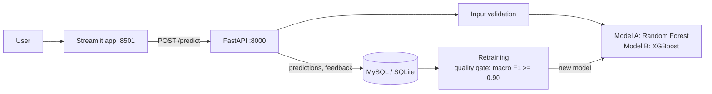

# Forest Cover Type: Multiclass Classification

[](https://github.com/IA-P1-BCN/AI-Project-Clasificacion-Multiclase_5/actions/workflows/ci.yml)

A machine learning system that predicts the dominant tree species (7 classes) of a
30 x 30 m forest cell from 54 cartographic features. It covers the whole path from
data analysis to a deployed application: modelling, a validated API, a web app, a
database with user feedback, retraining, Docker, tests with CI, an A/B test between
two models and data drift monitoring.

**Live demo:** https://multiclass-covertype-app.onrender.com

> The demo runs on a free Render instance. It sleeps after 15 minutes without
> traffic, and waking it up (download and load of the model) can take several
> minutes. Its database is not persistent. See [docs/APP.md](docs/APP.md#deployment).

## Results

The exported model is a Random Forest (100 trees) fitted on the training split only.
Metrics on data it never saw:

| Partition | Rows | Accuracy | Macro F1 |
|---|---:|---:|---:|
| Validation | 87,152 | 0.9520 | 0.9186 |
| Test | 87,152 | 0.9510 | 0.9199 |

- **Overfitting:** train accuracy 1.0000 against validation 0.9520, a gap of
  **4.80 points**, below the 5% quality gate. The gap in macro F1 is larger
  (about 8 points); see [docs/MODELING.md](docs/MODELING.md).
- **Main metric:** macro F1, because the classes are strongly imbalanced (1:103 between
  the rarest and the most frequent). Every class reaches F1 >= 0.84 on the test split;
  the weakest is Aspen (0.8410).
- **Model comparison** (5-fold stratified cross-validation, same split for all):

| Model | Macro F1 |
|---|---:|
| Random Forest | 0.9124 |
| MLP (128, 64) | 0.8557 |
| XGBoost | 0.8514 |
| LightGBM | 0.8261 |
| Logistic Regression | 0.5324 |

- **Errors:** two thirds of the mistakes are the confusion between Spruce/Fir and
  Lodgepole Pine, whose elevation ranges genuinely overlap. `Elevation` is the dominant
  feature under impurity, permutation and SHAP importance.

Full analysis: [docs/TECHNICAL_REPORT.md](docs/TECHNICAL_REPORT.md).

## How it works



1. The user enters 12 compact values (10 numeric features, wilderness area 1 to 4 and
   soil type 1 to 40) in the Streamlit app.
2. The app calls `POST /predict`. The API validates ranges (HTTP 422 if invalid),
   expands the two categorical values into the 44 indicator columns and runs the model.
3. The response has the cover type, species name, confidence and the 7 class
   probabilities. The prediction is stored with an id.
4. The user can send the true class with `POST /feedback`; `GET /metrics` reports live
   accuracy from that feedback.

## Features by delivery level

| Level | What is delivered |
|---|---|
| Essential | EDA, multiclass model, overfitting below 5%, web app, metrics report |
| Medium | Ensemble models, stratified cross-validation, hyperparameter tuning, feedback system, retraining pipeline with quality gate |
| Advanced | Docker Compose (database, API, app), MySQL, cloud deployment, unit and end-to-end tests, CI |
| Expert | Neural network (MLP), A/B test between two models, data drift monitoring with alerts, SHAP interpretability |

## Quick start

**Requirements:** Docker with Compose v2.24 or newer, and the dataset (below).

```bash
git clone https://github.com/IA-P1-BCN/AI-Project-Clasificacion-Multiclase_5.git
cd AI-Project-Clasificacion-Multiclase_5
```

1. **Dataset.** It is not stored in Git. Download `covertype.zip` from
   https://archive.ics.uci.edu/static/public/31/covertype.zip, extract and decompress
   `covtype.data.gz`, and place `covtype.data` in `data/raw/`. Expected SHA-256:
   `0a9371cef7c964b5475d6053cc3e0894a5aa6f65ad1ed3ecb01c45aa96217945`.
2. **Start the stack.**

   ```bash
   docker compose up --build -d
   ```

3. **Export the model** (once per clone, about two minutes; models are not in Git),
   then restart the API, which loads the model only at startup:

   ```bash
   docker compose exec app python src/export_model.py
   docker compose restart api
   ```

4. **Open** the app at http://localhost:8501 and the API docs (Swagger) at
   http://localhost:8000/docs. Check the API with `curl http://localhost:8000/health`
   (`model_loaded` and `db_connected` must be `true`).

To stop: `docker compose down` (the database volume survives; `-v` deletes it).
Local development without Docker, the pinned environment and a clean-clone checklist:
[docs/REPRODUCIBILITY.md](docs/REPRODUCIBILITY.md). Services, volumes and fixes for
common errors: [docs/DOCKER.md](docs/DOCKER.md).

Run the tests with `docker compose run --rm --no-deps app python -m pytest`
([docs/TESTING.md](docs/TESTING.md)).

## API

| Endpoint | Purpose |
|---|---|
| `GET /health` | Service status, model loaded, database reachable |
| `POST /predict` | Validate input and return the cover type with its confidence |
| `POST /feedback` | Store the true class of an earlier prediction |
| `GET /metrics` | Live accuracy and per-class results from feedback |
| `GET /ab/results` | A/B test between two models and the decision |
| `GET /drift` | Data drift (PSI) of the received inputs |

Example:

```bash
curl -X POST http://localhost:8000/predict -H "Content-Type: application/json" -d '{
  "Elevation": 2900, "Aspect": 150, "Slope": 12,
  "Horizontal_Distance_To_Hydrology": 250, "Vertical_Distance_To_Hydrology": 40,
  "Horizontal_Distance_To_Roadways": 2300,
  "Hillshade_9am": 215, "Hillshade_Noon": 225, "Hillshade_3pm": 140,
  "Horizontal_Distance_To_Fire_Points": 1900,
  "Wilderness_Area": 1, "Soil_Type": 29
}'
```

Input bounds, response fields and error codes: [docs/APP.md](docs/APP.md).

## Methodology in short

- **Data:** UCI Covertype (dataset 31), 581,012 rows, 54 features, 7 classes, no nulls
  and no duplicates. Roosevelt National Forest, Colorado. License CC BY 4.0.
- **Split:** stratified 70 / 15 / 15 (406,708 train, 87,152 validation, 87,152 test),
  `random_state=42`. The test split is used once, for the final evaluation.
- **No data leakage:** everything that learns from data (clipping bounds, scaler, model)
  is fitted on training rows inside a scikit-learn `Pipeline`.
- **Outliers:** clipped to training IQR fences, no row removed.
- **Imbalance:** class weights were tested and did not improve macro F1, so they are not used.
- **Tuning:** `RandomizedSearchCV`. Tuned cross-validation scores (Random Forest 0.9326,
  XGBoost 0.9240) are optimistic because the parameters were chosen on the same folds.

## Limitations

- The served Random Forest is the untuned one. Re-exporting the tuned forest and the
  engineered features measured in the feature engineering step (+0.039 macro F1 on XGBoost)
  are documented next steps, not part of the shipped model.
- The cloud demo serves model B (tuned XGBoost, validation accuracy 0.9471, macro F1
  0.9244) because the Random Forest needs about 1.17 GiB of RAM and the free plan has 512 MB.
- The A/B decision rule compares accuracy; model B has the better macro F1.
- Drift monitoring covers input drift only, and has not been tested with real traffic.
- The data comes from a single forest at a single point in time.

## Documentation

| Document | Contents |
|---|---|
| [docs/TECHNICAL_REPORT.md](docs/TECHNICAL_REPORT.md) | Consolidated methodology, metrics, confusion matrix, importance, error analysis |
| [docs/EDA.md](docs/EDA.md) | Dataset audit, class distribution, feature analysis |
| [docs/PREPROCESSING.md](docs/PREPROCESSING.md) | Cleaning, outliers, scaling, encoding, split, imbalance, feature engineering |
| [docs/MODELING.md](docs/MODELING.md) | Baselines, model comparison, tuning, final metrics, SHAP |
| [docs/APP.md](docs/APP.md) | API, export, database, retraining, Docker, deployment |
| [docs/AB_TESTING.md](docs/AB_TESTING.md) | A/B test: design, decision rule and results |
| [docs/DRIFT_MONITORING.md](docs/DRIFT_MONITORING.md) | Drift metric, thresholds, calibration and results |
| [docs/TESTING.md](docs/TESTING.md) | Test suite and how to run it |
| [docs/DOCKER.md](docs/DOCKER.md) | Services, volumes, troubleshooting |
| [docs/REPRODUCIBILITY.md](docs/REPRODUCIBILITY.md) | Clean-clone run, pinned environment |
| [docs/USER_STORIES.md](docs/USER_STORIES.md) | User stories and the issues that implement them |
| [docs/DELIVERABLES.md](docs/DELIVERABLES.md) | Deliverables, quality gates and status |
| [docs/DATA_DICTIONARY.md](docs/DATA_DICTIONARY.md), [docs/DATASET_SELECTION.md](docs/DATASET_SELECTION.md), [data/README.md](data/README.md) | Columns, why this dataset, source and checksum |
| [docs/GUIA_PROYECTO_CLASIFICACION.md](docs/GUIA_PROYECTO_CLASIFICACION.md) | Living guide of decisions (Spanish) |
| [SPEC.md](SPEC.md), [specs/](specs/README.md) | Technical specification and one spec per branch |

## Repository structure

```
.
├── README.md
├── SPEC.md
├── CONTRIBUTING.md        # Git workflow and commit convention
├── AGENTS.md              # Rules for AI coding agents
├── specs/                 # Ontology and one spec per branch
├── Dockerfile
├── docker-compose.yml     # db, api and app services
├── render.yaml            # Render Blueprint (cloud deployment)
├── requirements.txt       # Pinned dependencies
├── .python-version        # 3.11
├── .env.example
├── app/                   # FastAPI (api, schemas, serving) and Streamlit (main)
├── src/                   # Preprocessing, training, evaluation, database, retraining, drift
├── scripts/               # check_imports.py (CI), start_cloud.py (cloud entrypoint)
├── tests/                 # pytest suite
├── docs/                  # Documentation and figures
├── data/                  # raw and processed data (git-ignored); data/README.md
└── models/                # Trained artifacts (git-ignored)
```

## Team

| Member | GitHub | Focus |
|---|---|---|
| Caro | n/a | Dataset, EDA, ensembles, evaluation |
| Levi | n/a | Cleaning, simple models, metrics, cloud deployment, presentation |
| Leandro | [@Leandroletoile](https://github.com/Leandroletoile) | Backend, Docker, DB, CI/CD, MLOps |
| Nayeli | n/a | Problem definition, modeling, app, docs |

## Contributing

Git Flow with `main`, `develop` and one branch, one spec and one pull request per
issue. Commits follow Conventional Commits and everything is written in English.
Details in [CONTRIBUTING.md](CONTRIBUTING.md).

## Data source

Blackard, J. (1998). *Covertype* [Dataset]. UCI Machine Learning Repository.
https://archive.ics.uci.edu/dataset/31/covertype. Licensed under CC BY 4.0.