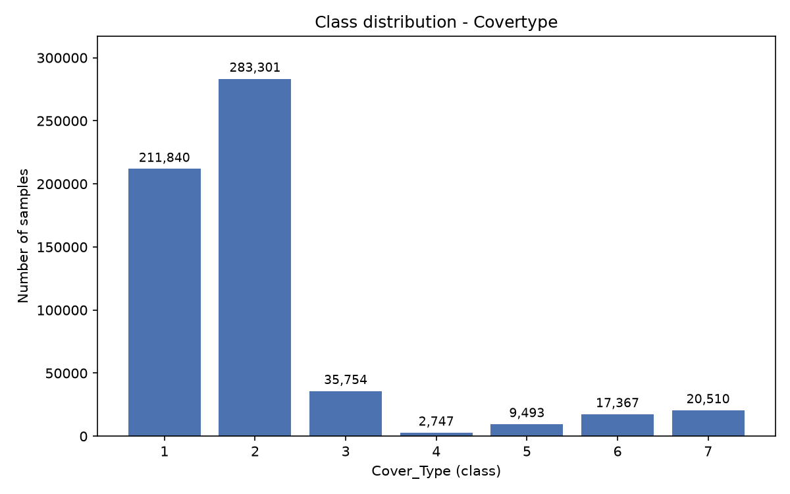
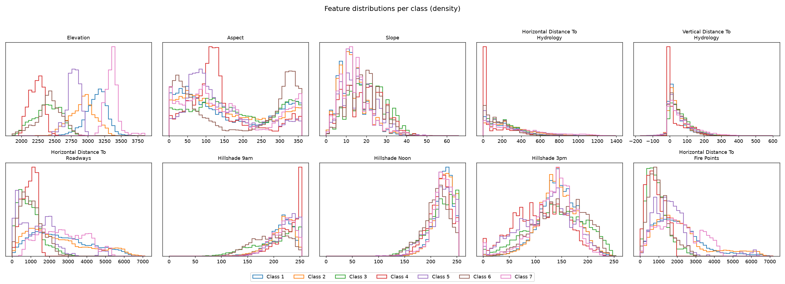
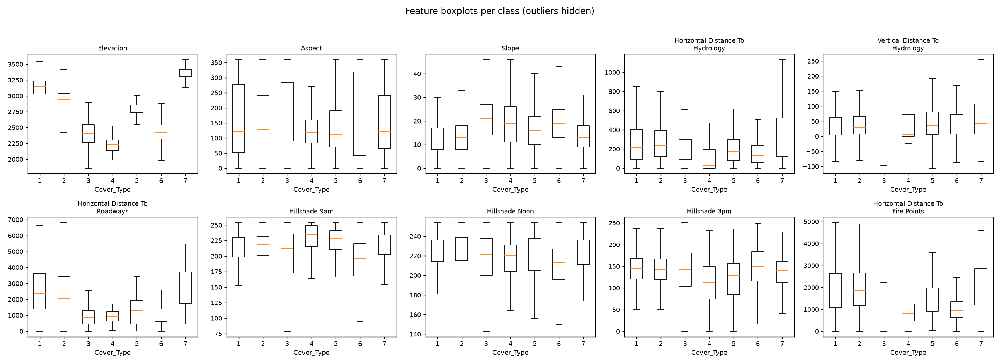
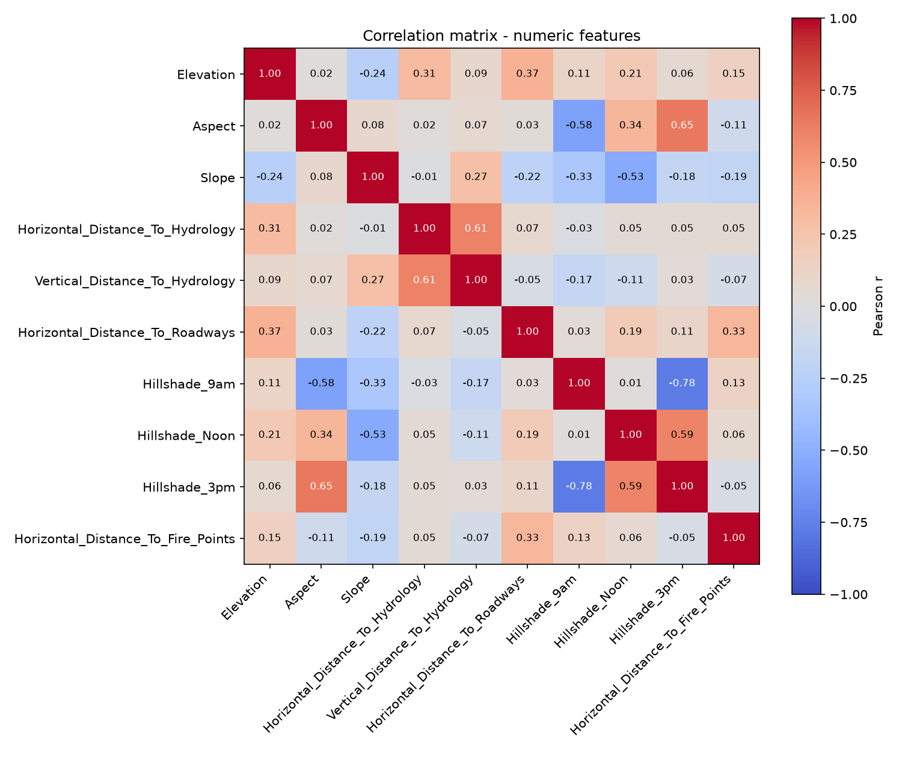
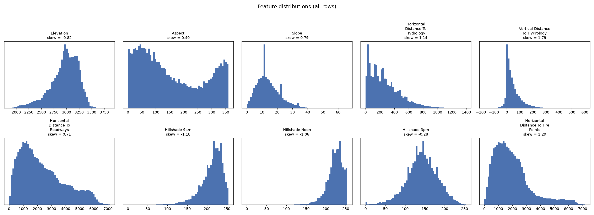
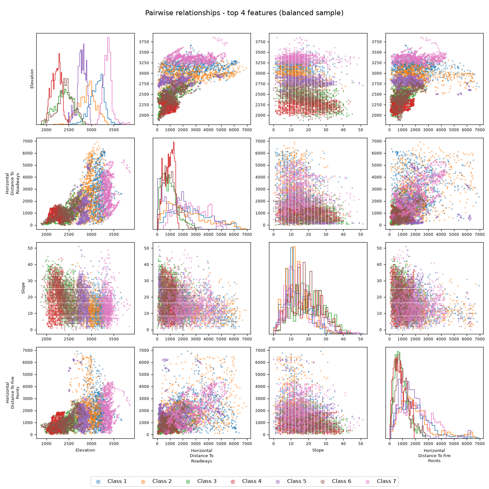
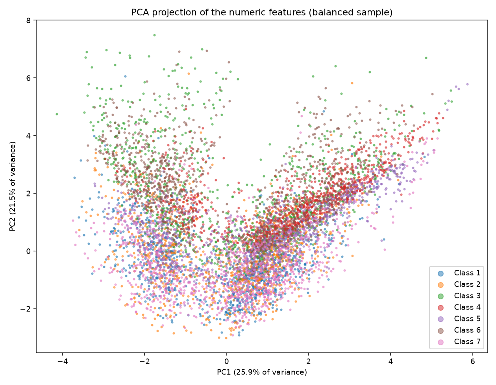

# EDA — Exploratory Data Analysis

> Plan and results of the exploratory data analysis.

## Contents

- [Plan](#plan)
- [Dataset audit](#dataset-audit)
- [Class distribution](#class-distribution)
- [Feature analysis](#feature-analysis)
- [Findings](#findings)

## Plan

- [x] Audit the dataset (rows, columns, dtypes, nulls, duplicates)
- [x] Analyze class distribution (frequencies, imbalance)
- [x] Analyze numeric features (histograms, boxplots)
- [x] Analyze feature correlations (correlation matrix)
- [x] Classification-specific visualizations (histograms per class)

## Dataset audit

Source: UCI Covertype (`data/raw/covtype.data`, no header; column names taken from `covtype.info`).
Dataset: download from https://archive.ics.uci.edu/dataset/31/covertype and place `covtype.data` in `data/raw/` (not tracked by Git).
Reproduce with: `python src/data_audit.py`

| Metric | Value |
|---|---|
| Rows | 581,012 |
| Columns | 55 (54 features + target `Cover_Type`) |
| Dtypes | 55 x int64 |
| Nulls | 0 |
| Duplicates | 0 |

### Data types

| Columns | Count | dtype |
|---|---|---|
| Elevation, Aspect, Slope, Horizontal_Distance_To_Hydrology, Vertical_Distance_To_Hydrology, Horizontal_Distance_To_Roadways, Hillshade_9am, Hillshade_Noon, Hillshade_3pm, Horizontal_Distance_To_Fire_Points | 10 | int64 |
| Wilderness_Area1 - Wilderness_Area4 | 4 | int64 |
| Soil_Type1 - Soil_Type40 | 40 | int64 |
| Cover_Type (target) | 1 | int64 |

### Audit findings

- Row and column counts match the official metadata (581,012 x 55).
- No null values and no fully duplicated rows were found. Nothing was removed or imputed (audit only).
- The raw file has no header; column names were assigned from the official documentation.
- The 44 binary indicator columns (Wilderness_Area, Soil_Type) and the categorical target `Cover_Type` (7 classes) are stored as int64, not as categorical/boolean types.

## Class distribution

Target: `Cover_Type` (7 classes). Reproduce with: `python src/class_distribution.py`

| Class | Count | Percentage |
|---|---|---|
| 1 | 211,840 | 36.46% |
| 2 | 283,301 | 48.76% |
| 3 | 35,754 | 6.15% |
| 4 | 2,747 | 0.47% |
| 5 | 9,493 | 1.63% |
| 6 | 17,367 | 2.99% |
| 7 | 20,510 | 3.53% |

**Imbalance:** the least frequent class (4, 2,747 samples) versus the most frequent (2, 283,301 samples) gives a min/max ratio of 0.0097, about 1:103. Classes 1 and 2 together account for about 85% of the samples.

**Is imbalance handling needed?** Yes. The imbalance is strong, so plain accuracy would be misleading (always predicting class 2 already gives about 49%). For M3 this suggests a stratified train/test split, evaluating with per-class metrics (e.g. macro F1) and considering techniques such as class weights or resampling. No balancing was applied here (analysis only).

## Feature analysis

Scope: the 10 quantitative features (the 44 binary `Wilderness_Area` / `Soil_Type` indicators are not included). Reproduce with: `python src/class_eda.py`

### Distributions per class

### Correlation matrix

Strongest correlations between numeric features (Pearson):

| Feature pair | r |
|---|---|
| Hillshade_9am / Hillshade_3pm | -0.780 |
| Aspect / Hillshade_3pm | 0.647 |
| Horizontal_Distance_To_Hydrology / Vertical_Distance_To_Hydrology | 0.606 |
| Hillshade_Noon / Hillshade_3pm | 0.594 |
| Aspect / Hillshade_9am | -0.579 |
| Slope / Hillshade_Noon | -0.527 |

No pair exceeds |r| = 0.8, so there is moderate (not extreme) redundancy. The hillshade features correlate with each other and with Aspect and Slope, which is consistent with hillshade being derived from terrain orientation and slope.

### Features that separate the classes

Eta squared (share of each feature's variance explained by `Cover_Type`; higher means the class means differ more):

| Feature | Eta squared |
|---|---|
| Elevation | 0.6160 |
| Horizontal_Distance_To_Roadways | 0.0959 |
| Slope | 0.0742 |
| Horizontal_Distance_To_Fire_Points | 0.0698 |
| Hillshade_9am | 0.0323 |
| Hillshade_Noon | 0.0293 |
| Horizontal_Distance_To_Hydrology | 0.0238 |
| Vertical_Distance_To_Hydrology | 0.0123 |
| Hillshade_3pm | 0.0106 |
| Aspect | 0.0046 |

- `Elevation` is by far the most discriminative numeric feature (61.6% of its variance is explained by the class).
- `Horizontal_Distance_To_Roadways`, `Slope` and `Horizontal_Distance_To_Fire_Points` show some separation (about 7-10%); the remaining features separate the classes weakly on their own.
- Limitation: eta squared only captures differences between class means. A feature with a low score may still help to tell some classes apart through the shape of its distribution, and the binary soil/wilderness indicators were not evaluated here.

### Deeper statistical insights

Reproduce with: `python src/statistical_insights.py`. Statistics use all rows; the pairplot and the PCA scatter use a balanced sample (1,000 rows per class) for visualization only.

#### Distributions

| Feature | Skewness | Excess kurtosis | % outside 1.5 x IQR |
|---|---|---|---|
| Elevation | -0.818 | 0.749 | 2.680 |
| Aspect | 0.403 | -1.220 | 0.000 |
| Slope | 0.789 | 0.581 | 2.636 |
| Horizontal_Distance_To_Hydrology | 1.140 | 1.366 | 2.505 |
| Vertical_Distance_To_Hydrology | 1.790 | 5.250 | 5.415 |
| Horizontal_Distance_To_Roadways | 0.714 | -0.384 | 0.115 |
| Hillshade_9am | -1.181 | 1.876 | 3.000 |
| Hillshade_Noon | -1.063 | 2.066 | 2.697 |
| Hillshade_3pm | -0.277 | 0.398 | 1.348 |
| Horizontal_Distance_To_Fire_Points | 1.289 | 1.646 | 5.363 |

- No feature is clearly normal. The closest is `Hillshade_3pm` (|skew| < 0.5, |excess kurtosis| < 1). Formal normality tests were not used: with 581,012 rows they reject normality for any real data.
- Strongest skew and heaviest tails: `Vertical_Distance_To_Hydrology` (skew 1.79, kurtosis 5.25), followed by `Horizontal_Distance_To_Fire_Points` (1.29) and `Horizontal_Distance_To_Hydrology` (1.14). `Hillshade_9am` and `Hillshade_Noon` are left-skewed (about -1.1).
- `Aspect` has the flattest distribution (excess kurtosis -1.22) and no values outside the IQR fences.
- The IQR rule flags up to 5.4% of rows (`Vertical_Distance_To_Hydrology`, `Horizontal_Distance_To_Fire_Points`). These are long tails of skewed variables; whether they are errors or legitimate values was not assessed and nothing was removed.

#### Pairwise relationships

Features shown: `Elevation`, `Horizontal_Distance_To_Roadways`, `Slope` and `Horizontal_Distance_To_Fire_Points` (the four highest eta squared in the previous section).

#### PCA projection

- PCA on the 10 standardized numeric features: PC1 explains 25.9% of the variance and PC2 21.5% (47.4% together). About 88.7% needs 6 components and 96.9% needs 8.
- PC10 explains about 0.0% and PC9 3.1%, which suggests an almost exact linear dependency among the numeric features. The hillshade features (derived from terrain orientation and slope) are a likely cause; this was not verified here.
- PC1 is dominated by `Hillshade_3pm` (-0.595), `Aspect` (-0.495) and `Hillshade_9am` (0.457), features that separate classes weakly (eta squared below 0.04). `Elevation` loads mostly on PC2 (-0.368). A 2D projection is therefore not expected to separate the classes well.

#### Insights for feature engineering (not applied; to evaluate in M3)

- Skewed distance features (`Vertical_Distance_To_Hydrology`, `Horizontal_Distance_To_Fire_Points`, `Horizontal_Distance_To_Hydrology`) could benefit from a transformation for linear or distance-based models; tree-based models are not sensitive to skew.
- `Aspect` is an angle in degrees (circular), so a sine/cosine encoding is a candidate.
- The horizontal and vertical distances to hydrology are correlated (r = 0.606) and could be combined into a single distance.
- The hillshade features are redundant with each other and with `Aspect` and `Slope`; for linear models, consider dropping or regularizing them.
- The features have very different scales, so scaling is needed for distance-based and linear models.

## Findings

Summary of the M2 exploratory analysis. The recommendations are inputs for M3 (cleaning and preprocessing); none of them has been applied yet.

### Key findings

| Area | Finding | Section |
|---|---|---|
| Data quality | 581,012 rows x 55 columns, no nulls, no duplicate rows, all columns int64. Nothing to clean regarding missing values or duplicates. | Dataset audit |
| Class balance | Strong imbalance: classes 1 and 2 hold about 85% of the rows, class 4 only 0.47% (min/max ratio 0.0097, about 1:103). | Class distribution |
| Separating features | `Elevation` dominates (eta squared 0.616). `Horizontal_Distance_To_Roadways` (0.096), `Slope` (0.074) and `Horizontal_Distance_To_Fire_Points` (0.070) contribute modestly; the other numeric features are weak on their own. | Feature analysis |
| Redundancy | No feature pair reaches 0.8 in absolute correlation (largest: `Hillshade_9am` / `Hillshade_3pm`, -0.78), but PC10 explains about 0% of the variance, which suggests an almost exact linear dependency among the numeric features. | Feature analysis |
| Distributions | No feature is clearly normal. Strongest skew: `Vertical_Distance_To_Hydrology` (1.79), `Horizontal_Distance_To_Fire_Points` (1.29), `Horizontal_Distance_To_Hydrology` (1.14). Up to 5.4% of rows fall outside the IQR fences. | Feature analysis |
| Representation | The 44 binary indicators and the target are stored as int64. `Aspect` is an angle in degrees. | Dataset audit |

### Recommendations for M3 (to be confirmed by the team)

1. **Class imbalance.** Use a stratified train/test split (and stratified cross-validation). Evaluate with per-class metrics and macro F1, not accuracy alone. Compare class weights and resampling, applying resampling only to training data.
2. **Missing values and duplicates.** Nothing to handle. Do not drop IQR outliers by default: they look like long tails of skewed variables, and they were not confirmed as errors.
3. **Scaling and transformations.** Scale the features for linear and distance-based models and consider transforming the skewed distance features. Tree-based models do not need either.
4. **Feature engineering candidates.** Sine/cosine encoding of `Aspect`; a combined distance to hydrology from the horizontal and vertical distances; check whether the hillshade features add information beyond `Aspect` and `Slope`.
5. **Redundancy.** For linear models, use regularization or drop a hillshade feature. First verify the linear dependency suggested by PCA.

### Limitations of this EDA

- The 44 binary `Wilderness_Area` / `Soil_Type` indicators were audited but not analyzed against the class; doing so in M3 may reveal useful features.
- Eta squared only captures differences between class means, and the 2D PCA projection is not expected to separate the classes well.
- No transformation, cleaning or balancing was applied in M2.

### Reproducibility

All scripts need `data/raw/covtype.data` (see the README) and save their figures in `docs/figures/`.

| Script | Produces |
|---|---|
| `src/data_audit.py` | Audit table (rows, columns, dtypes, nulls, duplicates) |
| `src/class_distribution.py` | Class frequencies, imbalance ratio, `class_distribution.png` |
| `src/class_eda.py` | `class_histograms.png`, `class_boxplots.png`, `correlation_matrix.png`, class separation ranking |
| `src/statistical_insights.py` | Skewness and kurtosis, `feature_distributions.png`, `pairplot_top_features.png`, `pca_projection.png` |
