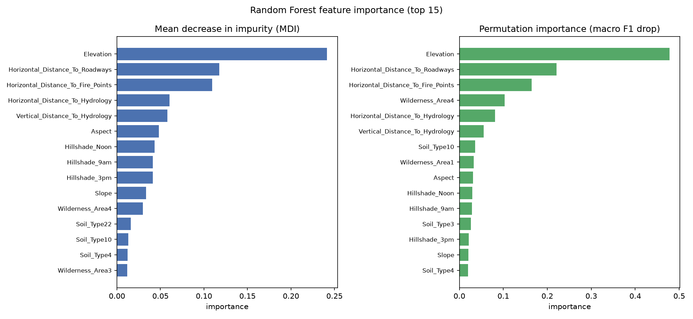
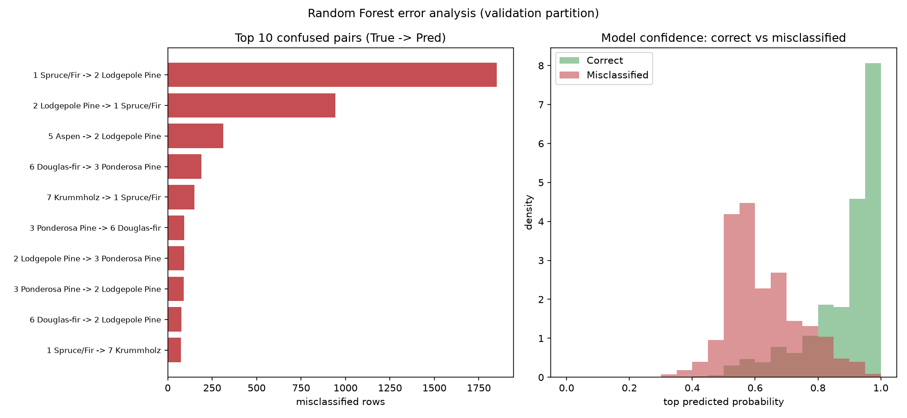
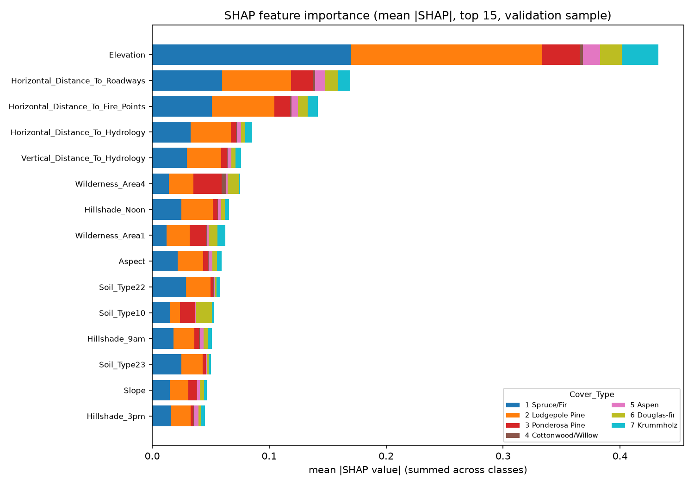
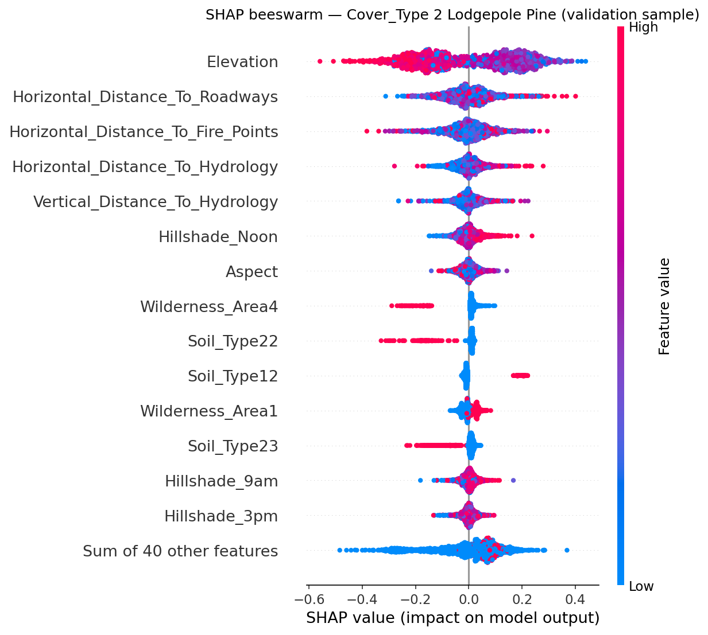
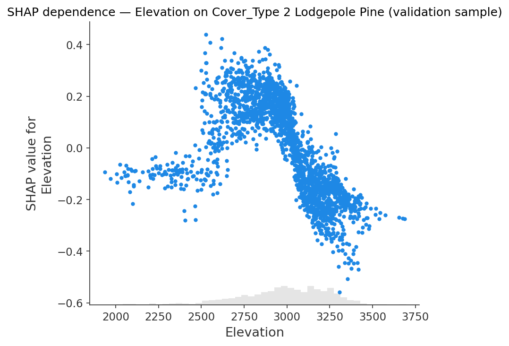

# MODELING — Strategy and Evaluation

> Modeling strategy, comparison and evaluation of models.

## Strategy

- Baseline + cross-validation protocol (StratifiedKFold)
- Simple model (Logistic Regression)
- Ensemble models (Random Forest, XGBoost, LightGBM)
- Hyperparameter optimization (GridSearchCV / RandomizedSearch / Optuna)

## Baseline & evaluation protocol

Issue #19. Reproduce with: `python src/baseline.py`

- **Protocol:** `StratifiedKFold(n_splits=5, shuffle=True, random_state=42)` on
  the training partition; metrics `accuracy` and **macro F1** (the main metric).
- **Entry point:** every model is evaluated with `evaluate_model(model, X, y)`
  so they are all compared on the same protocol.

### Baselines (5-fold CV on 406,708 training rows)

| Baseline | Accuracy | Macro F1 |
|---|---|---|
| DummyClassifier(most_frequent) | 0.4876 ± 0.0000 | 0.0937 ± 0.0000 |
| DummyClassifier(stratified) | 0.3770 ± 0.0011 | 0.1426 ± 0.0009 |

`most_frequent` has the best accuracy (it always guesses the majority class)
but the worst macro F1, because it never predicts the minority classes — which
is why macro F1 is the main metric on this imbalanced dataset. Every real model
must beat these scores.

## Simple model: Logistic Regression

Issue #20. Reproduce with: `python src/logistic_regression.py`

- **Model:** `Pipeline` of the preprocessor from #14 (`StandardScaler` on
  `NUMERIC_FEATURES`, `BINARY_FEATURES` passed through) and
  `LogisticRegression(max_iter=1000, random_state=42)` with default
  hyperparameters (multinomial loss, L2, `C=1.0`). No class weights (#17) and
  no tuning (#29): this is the untuned supervised reference.
- **Data:** the train set of the canonical split (`split_train_val_test`,
  #16), 406,708 rows. Validation and test sets are not used.
- **No leakage:** the scaler is a `Pipeline` step, so it is refitted on each
  training fold.
- **Convergence:** every fit stops below `max_iter`: 223, 233, 269, 240 and
  234 iterations on the five CV folds, 219 on the full train set. The script
  reads `n_iter_` of each fold's model and fails if any fit reaches
  `max_iter`.

### Cross-validation scores (5 folds)

| Model | Accuracy | Macro F1 |
|---|---|---|
| LogisticRegression | 0.7248 ± 0.0008 | 0.5324 ± 0.0037 |

### Per-class metrics (out-of-fold predictions on the train set)

| `Cover_Type` | Name | Precision | Recall | F1 | Support |
|---|---|---|---|---|---|
| 1 | Spruce/Fir | 0.7116 | 0.6979 | 0.7047 | 148,288 |
| 2 | Lodgepole Pine | 0.7483 | 0.8007 | 0.7736 | 198,311 |
| 3 | Ponderosa Pine | 0.6805 | 0.8035 | 0.7369 | 25,028 |
| 4 | Cottonwood/Willow | 0.6381 | 0.4254 | 0.5105 | 1,923 |
| 5 | Aspen | 0.2360 | 0.0063 | 0.0123 | 6,645 |
| 6 | Douglas-fir | 0.4891 | 0.2701 | 0.3480 | 12,157 |
| 7 | Krummholz | 0.7262 | 0.5742 | 0.6413 | 14,356 |
| | Macro average | 0.6042 | 0.5112 | 0.5325 | 406,708 |

The macro F1 of this table (0.5325) is computed once over all out-of-fold
predictions pooled together, while the one in the cross-validation scores
(0.5324) is the mean of the five per-fold macro F1 values.

Logistic regression clearly beats both baselines (macro F1 0.5324 against
0.1426), so the features carry signal that a linear model can use. It is
stable across folds, but its macro F1 is far below its accuracy: the two
majority classes are predicted reasonably well while Aspen (5) is almost
never predicted (recall 0.0063) and Douglas-fir (6) is missed three times out
of four. A linear decision boundary and the class imbalance both contribute;
#17 (imbalance handling) and the non-linear models address them.

## Models comparison and shortlist

Issue #23. Reproduce every model (the MLP CV takes about an hour) with:
`python src/model_comparison.py`. The fast subset — the gradient-boosted models
and the baselines — reproduces with:
`python src/model_comparison.py XGBoost LightGBM "DummyClassifier (most_frequent)" "DummyClassifier (stratified)"`

Every model is evaluated on the **same** canonical train split
(`split_train_val_test`, #16; 406,708 rows) with the **same** protocol
(`StratifiedKFold(n_splits=5, shuffle=True, random_state=42)`, macro F1 the main
metric), so the rows are comparable. `LogisticRegression` (#20),
`RandomForest` (#21) and `MLP` (#24) were already produced on this split, so
their numbers are reused; `XGBoost`, `LightGBM` and the `DummyClassifier`
baselines were re-run here on the canonical split (in #22 / #19 they used a
different 70% partition). Accuracy and macro F1 are the mean ± standard
deviation over the five folds; macro precision / recall come from pooled
out-of-fold predictions.

| Rank | Model | Accuracy | Precision (macro) | Recall (macro) | F1 (macro) |
|---|---|---|---|---|---|
| 1 | RandomForest (100 trees) | 0.9470 | 0.9373 | 0.8918 | **0.9124 ± 0.0023** |
| 2 | MLP (128, 64) | 0.9035 | 0.8716 | 0.8420 | 0.8557 ± 0.0090 |
| 3 | XGBoost | 0.8693 | 0.8833 | 0.8288 | 0.8514 ± 0.0038 |
| 4 | LightGBM | 0.8561 | 0.8504 | 0.8122 | 0.8261 ± 0.0082 |
| 5 | LogisticRegression | 0.7248 | 0.6042 | 0.5112 | 0.5324 ± 0.0037 |
| — | DummyClassifier (stratified) | 0.3767 | 0.1433 | 0.1433 | 0.1433 ± 0.0013 |
| — | DummyClassifier (most_frequent) | 0.4876 | 0.0697 | 0.1429 | 0.0937 ± 0.0000 |

### F1 per class (same split and protocol)

| `Cover_Type` | Name | RandomForest | MLP | XGBoost | LightGBM | LogReg |
|---|---|---|---|---|---|---|
| 1 | Spruce/Fir | 0.9459 | 0.8987 | 0.8508 | 0.8343 | 0.7047 |
| 2 | Lodgepole Pine | 0.9551 | 0.9182 | 0.8816 | 0.8705 | 0.7736 |
| 3 | Ponderosa Pine | 0.9422 | 0.8990 | 0.9046 | 0.8924 | 0.7369 |
| 4 | Cottonwood/Willow | 0.8687 | 0.8137 | 0.8728 | 0.7817 | 0.5105 |
| 5 | Aspen | 0.8213 | 0.7312 | 0.6968 | 0.7109 | 0.0123 |
| 6 | Douglas-fir | 0.8993 | 0.8110 | 0.8270 | 0.8066 | 0.3480 |
| 7 | Krummholz | 0.9547 | 0.9187 | 0.9266 | 0.9055 | 0.6413 |

### Ranking

1. **Random Forest** is the clear winner: best macro F1 (0.9124), best accuracy
   (0.9470), the most stable (std 0.0023) and the best or near-best F1 on every
   class, including the hardest one, Aspen (0.8213).
2. **MLP** and **XGBoost** are a near tie on macro F1 (0.8557 vs 0.8514, within
   one standard deviation). The MLP has higher accuracy (+3.4 points) and is
   stronger on the two majority classes; XGBoost is more stable (std 0.0038 vs
   0.0090), the best model on the rarest class, Cottonwood/Willow (0.8728), and
   trains in minutes rather than ~1 hour.
3. **LightGBM** trails XGBoost in six of the seven classes (it is slightly
   ahead only on Aspen, 0.7109 vs 0.6968), and **logistic regression**, while
   far above the baselines, is well behind the non-linear models and barely
   predicts Aspen (F1 0.0123).

### Shortlist (agreed by the team)

- **Primary — Random Forest:** strongest and most stable model; carry it to
  tuning (#29) and deployment (#32 / #34).
- **Secondary — XGBoost:** the more practical of the two near-tied runners-up —
  stable across folds (std 0.0038 vs the MLP's 0.0090) and trains in minutes
  rather than ~1 hour, at essentially the same macro F1. On the rarest class,
  Cottonwood/Willow, it is on par with Random Forest (0.8728 vs 0.8687, within
  the fold-to-fold noise). The **MLP** is a close alternative if accuracy on the
  majority classes is prioritized, but it is an order of magnitude slower to
  train.

Before Random Forest is carried to deployment, two things still need measuring:
its overfitting gap (#28 — resolved: accuracy gap +4.80 points, below the 5 %
gate) — the forest runs without `max_depth`, so the < 5 % criterion may not
hold as is — and the size of the serialized model
(`.joblib`), which the API loads at start-up and Docker packages (#34). Tuning
(#29) should also try the eight selected features of #18 on Random Forest; they
lifted XGBoost in validation but have not been tested on the forest.

> All models are untuned (#29) and use default hyperparameters without class
> weights (#17), so the ranking may shift after tuning and imbalance handling.
> Scores are on the train split under cross-validation; final metrics on the
> validation / test partitions belong to #25.

## Neural network (MLP)

Issue #24. Reproduce with: `python src/neural_network.py` (about one hour on
8 CPU cores; a single fit on the train set takes about 10 minutes).

- **Model:** `Pipeline` of the preprocessor from #14 (`StandardScaler` on
  `NUMERIC_FEATURES`, `BINARY_FEATURES` passed through) and scikit-learn
  `MLPClassifier(hidden_layer_sizes=(128, 64), batch_size=512, max_iter=200,
  random_state=42)`: two hidden ReLU layers, softmax output over the 7
  classes, Adam optimizer. An MLP rather than a CNN because the Covertype
  dataset is tabular. No new dependency.
- **Early stopping:** `early_stopping=True`, `validation_fraction=0.1`,
  `n_iter_no_change=10`. The hold-out is taken from the rows passed to `fit`
  (training rows only). On the full train set training stopped at epoch 99 of
  200, with a best internal hold-out accuracy of 0.9122.
- **Data:** the train set of the canonical split (`split_train_val_test`,
  #16), 406,708 rows. Validation and test sets are not used.
- **No leakage:** the scaler is a `Pipeline` step, so it is refitted on each
  training fold. No class weights (#17) and no tuning (#29).

### Cross-validation scores (5 folds)

| Model | Accuracy | Macro F1 |
|---|---|---|
| MLP (128, 64) | 0.9035 ± 0.0049 | 0.8557 ± 0.0090 |

### Per-class metrics (out-of-fold predictions on the train set)

| `Cover_Type` | Name | Precision | Recall | F1 | Support |
|---|---|---|---|---|---|
| 1 | Spruce/Fir | 0.9082 | 0.8895 | 0.8987 | 148,288 |
| 2 | Lodgepole Pine | 0.9077 | 0.9290 | 0.9182 | 198,311 |
| 3 | Ponderosa Pine | 0.8923 | 0.9058 | 0.8990 | 25,028 |
| 4 | Cottonwood/Willow | 0.8332 | 0.7951 | 0.8137 | 1,923 |
| 5 | Aspen | 0.8025 | 0.6715 | 0.7312 | 6,645 |
| 6 | Douglas-fir | 0.8196 | 0.8027 | 0.8110 | 12,157 |
| 7 | Krummholz | 0.9376 | 0.9005 | 0.9187 | 14,356 |
| | Macro average | 0.8716 | 0.8420 | 0.8558 | 406,708 |

### Comparison against the ensemble models (#22)

| Model | Accuracy | Macro F1 | Macro F1 std |
|---|---|---|---|
| MLP (128, 64) | 0.9035 | 0.8557 | 0.0090 |
| XGBoost | 0.8690 | 0.8494 | 0.0012 |
| LightGBM | 0.8540 | 0.8175 | 0.0266 |

F1 per class:

| `Cover_Type` | Name | MLP | XGBoost | LightGBM |
|---|---|---|---|---|
| 1 | Spruce/Fir | 0.8987 | 0.8510 | 0.8332 |
| 2 | Lodgepole Pine | 0.9182 | 0.8820 | 0.8698 |
| 3 | Ponderosa Pine | 0.8990 | 0.8999 | 0.8927 |
| 4 | Cottonwood/Willow | 0.8137 | 0.8553 | 0.7084 |
| 5 | Aspen | 0.7312 | 0.7213 | 0.7042 |
| 6 | Douglas-fir | 0.8110 | 0.8137 | 0.8088 |
| 7 | Krummholz | 0.9187 | 0.9226 | 0.9052 |

- The MLP has the best accuracy (+3.5 points over XGBoost) because it
  separates the two majority classes, Spruce/Fir and Lodgepole Pine, better.
- On macro F1 the MLP and XGBoost are close (0.8557 against 0.8494). XGBoost
  is better on the rarest class, Cottonwood/Willow (0.8553 against 0.8137),
  and is more stable across folds.
- Aspen (5) is the hardest class for all three models.
- Cost: one MLP fit takes about 10 minutes on CPU, far more than the
  gradient-boosted models.
- Caveats: all three models are untuned (#29), and the ensemble scores were
  obtained in #22 on a different 70% train partition of the same size
  (406,708 rows), so differences of a few thousandths are not conclusive.
  Random Forest (#21) is added below (section *Ensemble model: Random Forest*).
  The equal-footing comparison and the shortlist are in *Models comparison and
  shortlist* (#23), where XGBoost / LightGBM are re-evaluated on the canonical
  split.

## Ensemble model: Random Forest

Issue #21. Reproduce with: `python src/random_forest.py` (about ten minutes on
8 CPU cores).

- **Model:** `RandomForestClassifier(n_estimators=100, random_state=42,
  n_jobs=-1)` with default hyperparameters (Gini impurity, no depth limit,
  bootstrap sampling, `sqrt` features per split). A bagging ensemble to set
  against the gradient-boosted ones (#22).
- **No scaling / no preprocessor:** a Random Forest splits on thresholds, so
  rescaling the numeric features has no effect; the model trains on the raw
  (cleaned) `FEATURES`. The forest is the only thing learned from data, and the
  CV routines refit it on each training fold, so there is no leakage.
- **Data:** the train set of the canonical split (`split_train_val_test`, #16),
  406,708 rows. Validation and test sets are not used.
- **Default hyperparameters.** Tuning belongs to #29 and class weights to #17;
  this issue records the untuned reference.
- **Reuse the protocol.** Accuracy and macro F1 come from
  `baseline.evaluate_model` (#19); per-class metrics come from out-of-fold
  predictions (`cross_val_predict`) over the same
  `StratifiedKFold(n_splits=5, shuffle=True, random_state=42)`.

### Cross-validation scores (5 folds)

| Model | Accuracy | Macro F1 |
|---|---|---|
| RandomForest (100 trees) | 0.9470 ± 0.0006 | 0.9124 ± 0.0023 |

### Per-class metrics (out-of-fold predictions on the train set)

| `Cover_Type` | Name | Precision | Recall | F1 | Support |
|---|---|---|---|---|---|
| 1 | Spruce/Fir | 0.9577 | 0.9344 | 0.9459 | 148,288 |
| 2 | Lodgepole Pine | 0.9420 | 0.9686 | 0.9551 | 198,311 |
| 3 | Ponderosa Pine | 0.9307 | 0.9539 | 0.9422 | 25,028 |
| 4 | Cottonwood/Willow | 0.9058 | 0.8346 | 0.8687 | 1,923 |
| 5 | Aspen | 0.9317 | 0.7344 | 0.8213 | 6,645 |
| 6 | Douglas-fir | 0.9214 | 0.8782 | 0.8993 | 12,157 |
| 7 | Krummholz | 0.9717 | 0.9383 | 0.9547 | 14,356 |
| | Macro average | 0.9373 | 0.8918 | 0.9125 | 406,708 |

Random Forest is the strongest model so far on both accuracy (0.9470) and macro
F1 (0.9124), ahead of the MLP (0.9035 / 0.8557) and XGBoost (0.8690 / 0.8494),
and it is very stable across folds (macro F1 std 0.0023). The imbalance still
shows: Aspen (5) has the lowest recall (0.7344) despite high precision, so the
forest predicts it conservatively — the classic minority-class pattern that #17
will address.

### Feature importance (mean decrease in impurity, full train set)

| Rank | Feature | Importance |
|---|---|---|
| 1 | `Elevation` | 0.2415 |
| 2 | `Horizontal_Distance_To_Roadways` | 0.1176 |
| 3 | `Horizontal_Distance_To_Fire_Points` | 0.1094 |
| 4 | `Horizontal_Distance_To_Hydrology` | 0.0606 |
| 5 | `Vertical_Distance_To_Hydrology` | 0.0578 |
| 6 | `Aspect` | 0.0481 |
| 7 | `Hillshade_Noon` | 0.0433 |
| 8 | `Hillshade_9am` | 0.0414 |
| 9 | `Hillshade_3pm` | 0.0411 |
| 10 | `Slope` | 0.0333 |

`Elevation` dominates (0.24), consistent with the EDA (most discriminative
feature, eta squared 0.616). The distance features follow. The top 10 are all
numeric, but this partly reflects a known bias of impurity-based importance
(MDI): it favours continuous, high-cardinality features over binary ones, so
the low individual scores of the one-hot `Wilderness_Area` and `Soil_Type`
indicators understate their role rather than measure it. A permutation
importance, or a gain-based importance (as explored in #18, where `Soil_Type`
columns rank highly), would order them differently. The permutation importance
below (#26) does exactly that on the shared split.

### Feature importance — permutation (validation partition, #26)

Issue #26. Reproduce with: `python src/feature_importance.py`. The Random Forest
is fitted on the training partition; each feature is then shuffled in the
held-out **validation** partition (87,152 rows) and the drop in macro F1 is
measured (`sklearn.inspection.permutation_importance`, `n_repeats=5`,
`random_state=42`). The model never saw these rows, so the measure is
leakage-free and model-agnostic, and it does not share the MDI bias toward
continuous features.

| Rank | Feature | Permutation importance (macro F1 drop) |
|---|---|---|
| 1 | `Elevation` | 0.4779 |
| 2 | `Horizontal_Distance_To_Roadways` | 0.2210 |
| 3 | `Horizontal_Distance_To_Fire_Points` | 0.1646 |
| 4 | `Wilderness_Area4` | 0.1028 |
| 5 | `Horizontal_Distance_To_Hydrology` | 0.0810 |
| 6 | `Vertical_Distance_To_Hydrology` | 0.0556 |
| 7 | `Soil_Type10` | 0.0356 |
| 8 | `Wilderness_Area1` | 0.0330 |
| 9 | `Aspect` | 0.0314 |
| 10 | `Hillshade_Noon` | 0.0291 |

`Elevation` again dominates by a wide margin, and the three distance features
remain the strongest numeric predictors, so the two measures agree on the head
of the ranking. The difference is exactly the bias the MDI note predicted: the
one-hot indicators climb once the high-cardinality advantage is removed —
`Wilderness_Area4` rises to 4th (0.1028, vs 11th under MDI) and `Soil_Type10`,
`Wilderness_Area1` and `Soil_Type3` enter the top 12. So the categorical
location features matter more to the model's decisions than their low MDI
scores suggest, while `Elevation` and the distance features are confirmed as the
dominant drivers of the cover-type prediction.

## Hyperparameter optimization

Issue #29. Reproduce with: `python src/hyperparameter_optimization.py`

- **Method:** `RandomizedSearchCV` (scikit-learn) under the shared protocol
  (`StratifiedKFold(n_splits=5, shuffle=True, random_state=42)`, scoring macro
  F1), on the canonical train split (406,708 rows). Validation and test are
  untouched. `Optuna` was rejected to avoid a new dependency and because its
  pruning does not apply to Random Forest; `GridSearchCV` is too slow.
- **Budget:** Random Forest `n_iter=10`, XGBoost `n_iter=30`.
- **Features:** the search runs on the canonical `FEATURES` (the 54 cleaned raw
  columns), without the engineered features of #18; the tuned results do not
  include feature engineering.
- **No leakage:** the search fits only on `X_train` / `y_train`; the best
  estimator is re-evaluated with `baseline.evaluate_model` on the same folds.
  The reported tuned score is slightly optimistic because the best parameters
  were selected on those folds; the unbiased verdict is #28 (validation) and
  #25 (test).

### Default vs tuned (5-fold CV, macro F1)

| Model | Default | Tuned |
|---|---|---|
| RandomForest (primary) | 0.9123 ± 0.0029 | **0.9326 ± 0.0019** |
| XGBoost (secondary) | 0.8489 ± 0.0027 | **0.9240 ± 0.0016** |

### Best parameters

- **Random Forest:** `n_estimators=400`, `min_samples_split=5`,
  `min_samples_leaf=1`, `max_features=None`, `max_depth=50`.
- **XGBoost:** `learning_rate=0.05`, `n_estimators=300`, `max_depth=12`,
  `subsample=0.8`, `colsample_bytree=0.8`, `min_child_weight=3`,
  `reg_lambda=0.0`, `reg_alpha=1.0`.

Tuning improves both models and makes them more stable (the std drops for both).
Random Forest remains the primary model (0.9326); the tuned XGBoost (0.9240) is
now a strong secondary, within ~0.9 points of the forest (its larger +7.5-point
gain partly reflects a lower starting default of 0.8489). The tuned Random
Forest grows 400 trees and lets each tree evaluate all 54 features
(`max_features=None`) instead of a sample; the `max_depth=50` bound barely
limits a tree on 406,708 rows with `min_samples_leaf=1`, so the gain is more
plausibly driven by `max_features=None` than by the depth cap. That is a
hypothesis — the search selects the best combination but does not isolate which
parameter caused it. The actual overfitting gap is measured in #28, not here.

## Evaluation metrics

- Accuracy
- Precision, recall and F1 per class
- Confusion matrix
- Feature importance
- Error analysis
- Overfitting check (< 5%)

## Results

Issue #25. Reproduce with: `python src/final_metrics.py`

- **Model:** the primary model of the shortlist (#23) and the exported pipeline
  of #32 (`export_model.build_pipeline` / `fit_pipeline`): a 54-feature
  passthrough `ColumnTransformer` followed by
  `RandomForestClassifier(n_estimators=100, random_state=42, n_jobs=-1)`.
  Per #17 (`docs/PREPROCESSING.md`), inverse-frequency class weights did not
  improve CV macro F1, so the model is unweighted. Hyperparameter tuning (#29)
  is still open; re-run `python src/final_metrics.py` if the configuration
  changes.
- **Data & no leakage:** canonical `split_train_val_test` (#16): 406,708
  training rows (70%), 87,152 validation rows (15%) and 87,152 held-out test
  rows (15%). The pipeline is fitted on `(X_train, y_train)` only; validation
  and test rows are never passed to `fit`.

### Headline metrics across partitions

| Partition | Rows | Accuracy | Precision (macro) | Recall (macro) | F1 (macro) |
|---|---:|---:|---:|---:|---:|
| `train` | 406,708 | 1.0000 | 1.0000 | 1.0000 | 1.0000 |
| `validation` | 87,152 | 0.9520 | 0.9416 | 0.8990 | 0.9186 |
| `test` | 87,152 | 0.9510 | 0.9423 | 0.9012 | 0.9199 |

- **Train vs validation accuracy gap (`overfitting_gap`):**
  `1.0000 - 0.9520 = +0.0480` (`+4.80` percentage points, below the 5% quality
  gate). ✅ **Verified in #28:** the requirement is met, so no regularization,
  simpler model or extra data is needed.
- **Validation vs test consistency:** test accuracy (`0.9510`) and test macro F1
  (`0.9199`) are within 0.10 and 0.13 percentage points of validation
  (`0.9520` and `0.9186`), which is consistent with the model generalizing to
  the held-out test set.

### Per-class metrics — Validation set (87,152 rows)

| `Cover_Type` | Name | Precision | Recall | F1 | Support |
|---|---|---:|---:|---:|---:|
| 1 | Spruce/Fir | 0.9638 | 0.9389 | 0.9512 | 31,776 |
| 2 | Lodgepole Pine | 0.9464 | 0.9728 | 0.9594 | 42,495 |
| 3 | Ponderosa Pine | 0.9357 | 0.9608 | 0.9481 | 5,363 |
| 4 | Cottonwood/Willow | 0.9122 | 0.8325 | 0.8706 | 412 |
| 5 | Aspen | 0.9263 | 0.7507 | 0.8293 | 1,424 |
| 6 | Douglas-fir | 0.9343 | 0.8898 | 0.9115 | 2,605 |
| 7 | Krummholz | 0.9723 | 0.9477 | 0.9598 | 3,077 |
| | Macro average | 0.9416 | 0.8990 | 0.9186 | 87,152 |
| | Weighted average | 0.9522 | 0.9520 | 0.9518 | 87,152 |

### Confusion matrix — Validation set (raw counts)

| True \ Pred | Pred 1 | Pred 2 | Pred 3 | Pred 4 | Pred 5 | Pred 6 | Pred 7 |
|---|---:|---:|---:|---:|---:|---:|---:|
| 1 Spruce/Fir | 29,835 | 1,852 | 0 | 0 | 9 | 6 | 74 |
| 2 Lodgepole Pine | 943 | 41,338 | 92 | 1 | 62 | 50 | 9 |
| 3 Ponderosa Pine | 0 | 90 | 5,153 | 17 | 11 | 92 | 0 |
| 4 Cottonwood/Willow | 0 | 0 | 60 | 343 | 0 | 9 | 0 |
| 5 Aspen | 24 | 312 | 13 | 0 | 1,069 | 6 | 0 |
| 6 Douglas-fir | 3 | 77 | 189 | 15 | 3 | 2,318 | 0 |
| 7 Krummholz | 149 | 12 | 0 | 0 | 0 | 0 | 2,916 |

### Confusion matrix — Validation set (row-normalized recall %)

| True \ Pred | Pred 1 | Pred 2 | Pred 3 | Pred 4 | Pred 5 | Pred 6 | Pred 7 |
|---|---:|---:|---:|---:|---:|---:|---:|
| 1 Spruce/Fir | 93.89% | 5.83% | 0.00% | 0.00% | 0.03% | 0.02% | 0.23% |
| 2 Lodgepole Pine | 2.22% | 97.28% | 0.22% | 0.00% | 0.15% | 0.12% | 0.02% |
| 3 Ponderosa Pine | 0.00% | 1.68% | 96.08% | 0.32% | 0.21% | 1.72% | 0.00% |
| 4 Cottonwood/Willow | 0.00% | 0.00% | 14.56% | 83.25% | 0.00% | 2.18% | 0.00% |
| 5 Aspen | 1.69% | 21.91% | 0.91% | 0.00% | 75.07% | 0.42% | 0.00% |
| 6 Douglas-fir | 0.12% | 2.96% | 7.26% | 0.58% | 0.12% | 88.98% | 0.00% |
| 7 Krummholz | 4.84% | 0.39% | 0.00% | 0.00% | 0.00% | 0.00% | 94.77% |

### Per-class metrics — Test set (87,152 rows)

| `Cover_Type` | Name | Precision | Recall | F1 | Support |
|---|---|---:|---:|---:|---:|
| 1 | Spruce/Fir | 0.9621 | 0.9376 | 0.9497 | 31,776 |
| 2 | Lodgepole Pine | 0.9454 | 0.9718 | 0.9584 | 42,495 |
| 3 | Ponderosa Pine | 0.9340 | 0.9627 | 0.9481 | 5,363 |
| 4 | Cottonwood/Willow | 0.9003 | 0.8544 | 0.8767 | 412 |
| 5 | Aspen | 0.9480 | 0.7556 | 0.8410 | 1,424 |
| 6 | Douglas-fir | 0.9380 | 0.8825 | 0.9094 | 2,605 |
| 7 | Krummholz | 0.9686 | 0.9435 | 0.9559 | 3,077 |
| | Macro average | 0.9423 | 0.9012 | 0.9199 | 87,152 |
| | Weighted average | 0.9512 | 0.9510 | 0.9507 | 87,152 |

### Confusion matrix — Test set (raw counts)

| True \ Pred | Pred 1 | Pred 2 | Pred 3 | Pred 4 | Pred 5 | Pred 6 | Pred 7 |
|---|---:|---:|---:|---:|---:|---:|---:|
| 1 Spruce/Fir | 29,793 | 1,895 | 1 | 0 | 7 | 3 | 77 |
| 2 Lodgepole Pine | 997 | 41,298 | 89 | 1 | 42 | 51 | 17 |
| 3 Ponderosa Pine | 0 | 88 | 5,163 | 21 | 7 | 84 | 0 |
| 4 Cottonwood/Willow | 0 | 0 | 50 | 352 | 0 | 10 | 0 |
| 5 Aspen | 19 | 310 | 15 | 0 | 1,076 | 4 | 0 |
| 6 Douglas-fir | 2 | 74 | 210 | 17 | 3 | 2,299 | 0 |
| 7 Krummholz | 155 | 19 | 0 | 0 | 0 | 0 | 2,903 |

### Confusion matrix — Test set (row-normalized recall %)

| True \ Pred | Pred 1 | Pred 2 | Pred 3 | Pred 4 | Pred 5 | Pred 6 | Pred 7 |
|---|---:|---:|---:|---:|---:|---:|---:|
| 1 Spruce/Fir | 93.76% | 5.96% | 0.00% | 0.00% | 0.02% | 0.01% | 0.24% |
| 2 Lodgepole Pine | 2.35% | 97.18% | 0.21% | 0.00% | 0.10% | 0.12% | 0.04% |
| 3 Ponderosa Pine | 0.00% | 1.64% | 96.27% | 0.39% | 0.13% | 1.57% | 0.00% |
| 4 Cottonwood/Willow | 0.00% | 0.00% | 12.14% | 85.44% | 0.00% | 2.43% | 0.00% |
| 5 Aspen | 1.33% | 21.77% | 1.05% | 0.00% | 75.56% | 0.28% | 0.00% |
| 6 Douglas-fir | 0.08% | 2.84% | 8.06% | 0.65% | 0.12% | 88.25% | 0.00% |
| 7 Krummholz | 5.04% | 0.62% | 0.00% | 0.00% | 0.00% | 0.00% | 94.35% |

## Error analysis

Issue #27. Reproduce with: `python src/error_analysis.py`

Same model and split as the *Results* section above (the exported pipeline of
#32, fitted on the 406,708 training rows only). The analysis runs on the
held-out **validation** partition (87,152 rows, 4,180 errors); the test
partition gives the same picture and is printed alongside it by the module.

### Most confused class pairs (validation, True → Pred)

| True → Pred | Count | % of that class's errors | % of all errors |
|---|---:|---:|---:|
| 1 Spruce/Fir → 2 Lodgepole Pine | 1,852 | 95.4% | 44.3% |
| 2 Lodgepole Pine → 1 Spruce/Fir | 943 | 81.5% | 22.6% |
| 5 Aspen → 2 Lodgepole Pine | 312 | 87.9% | 7.5% |
| 6 Douglas-fir → 3 Ponderosa Pine | 189 | 65.9% | 4.5% |
| 7 Krummholz → 1 Spruce/Fir | 149 | 92.6% | 3.6% |

- **One confusion dominates.** The reciprocal Spruce/Fir ↔ Lodgepole Pine
  confusion is 2,795 of the 4,180 validation errors (**66.9%**). These are the
  two majority classes (31,776 and 42,495 rows) and account for the model's two
  lowest per-class precisions once their large support is considered.
- **Every minority class leaks into a single neighbour.** Aspen's errors are
  almost entirely → Lodgepole Pine (87.9%), which explains its low recall
  (0.751, the worst of the seven); Krummholz → Spruce/Fir (92.6%) and
  Douglas-fir → Ponderosa Pine (65.9%) follow the same one-to-one pattern.
  Errors are concentrated, not spread across all classes — a few decision
  boundaries, not a globally weak model.

### Why they are confused — Elevation overlap

`Elevation` is the single most discriminative feature (η² 0.616; top of #26).
For the dominant pair it cleanly explains the confusion:

| Group (validation) | Rows | Elevation mean | Elevation std |
|---|---:|---:|---:|
| True Spruce/Fir, predicted Spruce/Fir (correct) | 29,835 | 3,139 m | 153 |
| True Spruce/Fir, predicted Lodgepole Pine (confused) | 1,852 | 2,941 m | 142 |
| True Lodgepole Pine (reference) | 42,495 | 2,920 m | 185 |

The misclassified Spruce/Fir rows sit ~200 m below the correctly classified
ones, right on top of the Lodgepole Pine mean (2,941 m vs 2,920 m). Spruce/Fir
trees at the low end of their elevation band fall inside Lodgepole Pine's range,
so the overlap is a genuine property of the data, not a model defect.

### Inspecting the misclassified rows — confidence

| Prediction | Rows | Mean confidence | Median | Share below 0.5 |
|---|---:|---:|---:|---:|
| Correct | 82,972 | 0.889 | 0.93 | 0.4% |
| Misclassified | 4,180 | 0.624 | 0.60 | 8.0% |

Errors sit at markedly lower confidence (top `predict_proba`) than correct
predictions and cluster near the 0.5–0.65 boundary (right panel of the figure):
most mistakes are borderline cases, not confident blunders. A residual tail of
high-confidence errors remains — e.g. Krummholz → Spruce/Fir and Lodgepole Pine
→ Spruce/Fir at 0.98 — where the features genuinely point at the wrong class.

### Proposed improvements

1. **Separate the Spruce/Fir ↔ Lodgepole Pine boundary (biggest payoff).** Two
   thirds of all errors live here. Hyperparameter tuning (#29) that grows deeper
   / less constrained trees, or a feature that sharpens the elevation–wilderness
   interaction (#18), targets exactly this boundary. Worth re-running this
   analysis after #29 to confirm the pair shrinks.
2. **Help the minority classes that collapse into one neighbour.** Aspen,
   Douglas-fir and Krummholz each lose to a single class. Imbalance handling was
   already evaluated in #17 and did not help global macro F1, but a targeted,
   pair-aware approach (class weights tuned for these specific classes, or
   engineered features that separate Aspen from Lodgepole Pine) is a more
   promising lever than generic resampling.
3. **Expose model confidence in the app.** Because errors concentrate below ~0.65
   confidence, surfacing the predicted probability (and optionally flagging
   low-confidence predictions for review) lets the Streamlit app communicate
   uncertainty where the model is in fact unsure, at no modelling cost.

These are diagnostic recommendations; acting on them belongs to #29 (tuning),
#18 (feature engineering) and the app issues, not to this ticket.

## Model interpretability (SHAP)

Issue #30 (optional / *Experto*). Reproduce with:
`python src/shap_interpretability.py`

SHAP attributes each prediction to its features with a signed contribution,
complementing the unsigned impurity/permutation importances of #26: it shows not
only *which* features matter but *in which direction* and *for which class*.

- **Model & data:** same exported pipeline as the *Results* section, fitted on
  the 406,708 training rows only; SHAP is computed on a reproducible sample of
  2,000 held-out **validation** rows (`random_state=42`). No leakage.
- **Approximate SHAP:** the forest grows unpruned (max depth 64, ~80k nodes per
  tree), so exact TreeSHAP costs ~3 s/row (hours for a useful sample). The module
  uses the fast approximate (Saabas) attribution, which is near-instant and
  preserves the ranking and sign the plots below rely on.

### Global feature importance (mean |SHAP|, validation sample)

| Rank | Feature | Mean \|SHAP\| (all classes) |
|---|---|---:|
| 1 | `Elevation` | 0.0618 |
| 2 | `Horizontal_Distance_To_Roadways` | 0.0242 |
| 3 | `Horizontal_Distance_To_Fire_Points` | 0.0202 |
| 4 | `Horizontal_Distance_To_Hydrology` | 0.0122 |
| 5 | `Vertical_Distance_To_Hydrology` | 0.0108 |
| 6 | `Wilderness_Area4` | 0.0108 |
| 7 | `Hillshade_Noon` | 0.0094 |

- **`Elevation` dominates**, with ~2.5× the mean |SHAP| of the next feature —
  the same verdict as the MDI and permutation rankings of #26, now confirmed by a
  third, signed method. The distance-to-roadways / fire-points / hydrology
  features follow, then the wilderness-area indicators and `Hillshade_Noon`.
- **The attribution is concentrated on the two majority classes.** For
  `Elevation`, mean |SHAP| is 0.170 for Spruce/Fir and 0.163 for Lodgepole Pine
  but ≤ 0.033 for the other five classes — the model leans hardest on elevation
  exactly where the dominant Spruce/Fir ↔ Lodgepole Pine confusion lives (#27).
  `Wilderness_Area4` and some soil types (`Soil_Type10`, `Soil_Type22`) are
  relatively more important for the minority classes (Ponderosa Pine,
  Douglas-fir).

### Effect direction — Lodgepole Pine

The beeswarm and the `Elevation` dependence plot for Lodgepole Pine make the
mechanism explicit: SHAP for `Elevation` is **positive (toward Lodgepole Pine)
up to ~2,900–3,000 m and turns sharply negative above it**. This is the same
boundary the error analysis (#27) found — Lodgepole Pine sits at a lower
elevation band (~2,920 m mean) and the model correctly pushes high-elevation
rows away from it toward Spruce/Fir. SHAP therefore corroborates that the
residual errors are a genuine elevation overlap between the two classes, not an
arbitrary model artefact.

The interpretation is diagnostic; it does not change the model.
