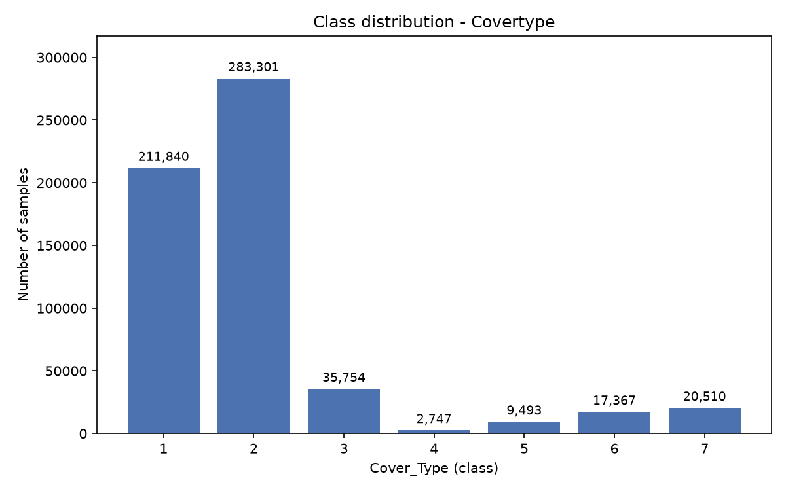
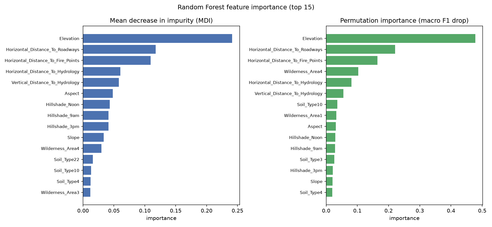
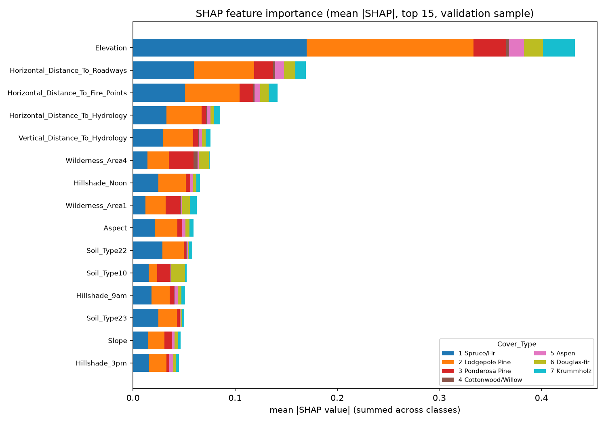
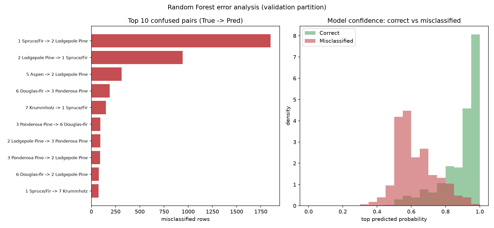

# Technical Report — Forest Cover Type Multiclass Classification

> Consolidated technical report for the UCI Covertype multiclass classification
> project (Team 5). It compiles the methodology, metrics, confusion matrix,
> feature importance and error analysis produced across milestones M2–M5 into a
> single end-to-end read, and states the decisions behind them. The per-stage
> records with the full tables are [EDA.md](EDA.md), [PREPROCESSING.md](PREPROCESSING.md)
> and [MODELING.md](MODELING.md); every figure lives in [docs/figures/](figures/).
> All numbers are reproduced from the code named in each section — nothing here
> is recomputed or estimated.

## Contents

- [1. Executive summary](#1-executive-summary)
- [2. Problem and dataset](#2-problem-and-dataset)
- [3. Exploratory analysis](#3-exploratory-analysis)
- [4. Methodology](#4-methodology)
- [5. Preprocessing and feature engineering](#5-preprocessing-and-feature-engineering)
- [6. Model comparison and selection](#6-model-comparison-and-selection)
- [7. Hyperparameter optimization](#7-hyperparameter-optimization)
- [8. Final model and results](#8-final-model-and-results)
- [9. Feature importance](#9-feature-importance)
- [10. Error analysis](#10-error-analysis)
- [11. Limitations and future work](#11-limitations-and-future-work)
- [12. Conclusions](#12-conclusions)
- [13. Reproducibility and export](#13-reproducibility-and-export)

## 1. Executive summary

The task is to predict the forest **cover type** (one of 7 tree-species classes)
of a 30 × 30 m cell from 54 cartographic features (UCI Covertype, 581,012 rows).
After an equal-footing comparison of six models under 5-fold stratified
cross-validation, **Random Forest** was selected and exported as the production
pipeline.

| Metric (exported model) | `validation` (87,152 rows) | `test` (87,152 rows) |
|---|---:|---:|
| Accuracy | 0.9520 | 0.9510 |
| Macro F1 | 0.9186 | 0.9199 |
| Macro precision | 0.9416 | 0.9423 |
| Macro recall | 0.8990 | 0.9012 |

- **Overfitting is controlled:** train accuracy 1.0000 vs validation 0.9520 is an
  **overfitting gap of +4.80 pp**, below the project's 5% quality gate.
- **Generalization holds:** test accuracy (0.9510) and macro F1 (0.9199) are
  within ~0.1 pp of validation.
- **Where the errors are:** two thirds of all mistakes are the reciprocal
  Spruce/Fir ↔ Lodgepole Pine confusion, explained by a genuine `Elevation`
  overlap between the two majority classes, not a model defect.

The shipped model is the **untuned** Random Forest on the 54 original features.
Tuning (#29) and feature engineering (#18) measured higher cross-validation
scores but are not yet in the exported pipeline; see
[§7](#7-hyperparameter-optimization) and [§11](#11-limitations-and-future-work).

## 2. Problem and dataset

- **Task:** supervised multiclass classification, 7 balanced-accuracy-relevant
  classes.
- **Target:** `Cover_Type`, integer 1–7 (dominant tree species of the cell).
- **Features:** 54 — 10 quantitative (elevation, aspect, slope, distances,
  hillshades) and 44 binary one-hot indicators (4 `Wilderness_Area`, 40
  `Soil_Type`).
- **Source:** [UCI Covertype](https://archive.ics.uci.edu/dataset/31/covertype),
  `data/raw/covtype.data` (no header; git-ignored). Audited with
  `python src/data_audit.py`.

| Audit metric | Value |
|---|---|
| Rows | 581,012 |
| Columns | 55 (54 features + target) |
| Dtypes | 55 × int64 |
| Nulls | 0 |
| Duplicate rows | 0 |

The data is clean on arrival: no missing values and no fully duplicated rows, so
no imputation or de-duplication is required (details in [EDA.md](EDA.md)).

### Class distribution



| Class | Name | Count | Share |
|---|---|---:|---:|
| 1 | Spruce/Fir | 211,840 | 36.46% |
| 2 | Lodgepole Pine | 283,301 | 48.76% |
| 3 | Ponderosa Pine | 35,754 | 6.15% |
| 4 | Cottonwood/Willow | 2,747 | 0.47% |
| 5 | Aspen | 9,493 | 1.63% |
| 6 | Douglas-fir | 17,367 | 2.99% |
| 7 | Krummholz | 20,510 | 3.53% |

The dataset is **strongly imbalanced**: classes 1 and 2 hold ~85% of the rows and
the rarest class (4) is 0.47% — a min/max ratio of about **1:103**. Accuracy alone
is therefore misleading (always predicting class 2 already scores ~49%), so
**macro F1** is the main metric throughout, together with per-class precision/
recall/F1.

## 3. Exploratory analysis

Full analysis and figures in [EDA.md](EDA.md) (`src/class_eda.py`,
`src/statistical_insights.py`). Headline findings:

- **`Elevation` is by far the most discriminative feature** (eta squared 0.616 —
  61.6% of its variance is explained by the class). `Horizontal_Distance_To_Roadways`
  (0.096), `Slope` (0.074) and `Horizontal_Distance_To_Fire_Points` (0.070)
  contribute modestly; the rest separate the classes weakly on their own.
- **Moderate, not extreme, redundancy.** No numeric pair exceeds |r| = 0.8
  (strongest: `Hillshade_9am` / `Hillshade_3pm`, −0.78). The hillshade features
  correlate with `Aspect` and `Slope`, consistent with hillshade being derived
  from terrain orientation. PCA suggests an almost exact linear dependency among
  the numeric features (PC10 ≈ 0% variance).
- **No feature is normal.** The strongest skew / heaviest tails are
  `Vertical_Distance_To_Hydrology` (skew 1.79), `Horizontal_Distance_To_Fire_Points`
  (1.29) and `Horizontal_Distance_To_Hydrology` (1.14); the IQR rule flags up to
  5.4% of rows as long-tail values (not confirmed as errors).

These informed the preprocessing choices in [§5](#5-preprocessing-and-feature-engineering).

## 4. Methodology

- **Canonical split (#16):** stratified 70 / 15 / 15 →
  **406,708 train / 87,152 validation / 87,152 test** rows
  (`src/data_split.py`, `split_train_val_test`, `random_state=42`).
  Stratification preserves every class share in each partition; the test set is
  used once, for the final evaluation.
- **Comparison protocol (#19):** `StratifiedKFold(n_splits=5, shuffle=True,
  random_state=42)` on the training partition only, scoring accuracy and macro
  F1. Every model is run through the same `evaluate_model(...)` entry point so
  the numbers are comparable.
- **No data leakage (hard rule):** anything that learns from data (scalers,
  clippers, the model) is fitted inside a scikit-learn `Pipeline`, so it is
  refitted on each training fold and never sees validation/test rows. The
  exported pipeline is fitted on `(X_train, y_train)` only.
- **Determinism:** `random_state=42` everywhere.

## 5. Preprocessing and feature engineering

Decisions and verification in [PREPROCESSING.md](PREPROCESSING.md). Summary:

| Step | Decision | Reason |
|---|---|---|
| Missing values / duplicates | None applied | Data is clean (0 nulls, 0 duplicate rows) |
| Outliers (#13) | **Clip (winsorize)** numeric features to the **training** IQR fences; drop no rows | Dropping IQR outliers would remove 18.5% of rows; the tails are legitimate skew, not confirmed errors. Bounds are learned in `fit` only |
| Scaling (#14) | `StandardScaler` on the 10 numeric features; binary passed through | Needed for linear/distance models; `StandardScaler` ≈ `RobustScaler` on CV macro F1 and is the conventional choice. Tree models do not need it |
| Target encoding (#15) | `Cover_Type` 1–7 ↔ 0–6 map, reversible | Clean label handling for libraries that expect 0-based labels |
| Imbalance (#17) | **No class weights, no SMOTE** | Inverse-frequency weights did **not** improve CV macro F1 for the tree models; recorded so M5 does not re-test it |
| Feature engineering (#18) | Candidates found (`elevation_offsets`, `distance_combinations` lift XGBoost CV macro F1 by ~+0.039); **no original feature dropped** | Removing features always lowered macro F1. The engineered features are **not** in the exported pipeline yet (see [§11](#11-limitations-and-future-work)) |

The exported Random Forest splits on thresholds, so it uses the **raw (cleaned)
54 features** with no scaling — the preprocessor is a passthrough
`ColumnTransformer` kept so the pipeline records `feature_names_in_` and a
scaling-sensitive model could be swapped in.

## 6. Model comparison and selection

Issue #23 — every model on the **same** canonical train split and the **same**
5-fold protocol (`python src/model_comparison.py`). Accuracy and macro F1 are
mean ± std over the five folds; macro precision/recall from pooled out-of-fold
predictions.

| Rank | Model | Accuracy | Precision (macro) | Recall (macro) | **F1 (macro)** |
|---|---|---:|---:|---:|---:|
| 1 | **RandomForest (100 trees)** | 0.9470 | 0.9373 | 0.8918 | **0.9124 ± 0.0023** |
| 2 | MLP (128, 64) | 0.9035 | 0.8716 | 0.8420 | 0.8557 ± 0.0090 |
| 3 | XGBoost | 0.8693 | 0.8833 | 0.8288 | 0.8514 ± 0.0038 |
| 4 | LightGBM | 0.8561 | 0.8504 | 0.8122 | 0.8261 ± 0.0082 |
| 5 | LogisticRegression | 0.7248 | 0.6042 | 0.5112 | 0.5324 ± 0.0037 |
| — | DummyClassifier (stratified) | 0.3767 | 0.1433 | 0.1433 | 0.1433 ± 0.0013 |
| — | DummyClassifier (most_frequent) | 0.4876 | 0.0697 | 0.1429 | 0.0937 ± 0.0000 |

**Random Forest is the clear winner:** best macro F1 (0.9124), best accuracy
(0.9470), the most stable (std 0.0023) and the best or near-best F1 on every
class, including the hardest one, Aspen (0.8213). The linear model clears the
baselines comfortably but trails the non-linear models and barely predicts Aspen
(F1 0.0123), confirming that non-linear decision boundaries and the imbalance
both matter.

**Shortlist:** primary **Random Forest** (carried to tuning and deployment);
secondary **XGBoost** — the more practical runner-up (stable, trains in minutes
vs ~1 hour for the MLP, on par with RF on the rarest class).

## 7. Hyperparameter optimization

Issue #29 — `RandomizedSearchCV` under the shared protocol, on the train split
only (`python src/hyperparameter_optimization.py`).

| Model | Default (CV macro F1) | Tuned (CV macro F1) |
|---|---:|---:|
| RandomForest (primary) | 0.9123 ± 0.0029 | **0.9326 ± 0.0019** |
| XGBoost (secondary) | 0.8489 ± 0.0027 | **0.9240 ± 0.0016** |

Best Random Forest parameters: `n_estimators=400`, `min_samples_split=5`,
`min_samples_leaf=1`, `max_features=None`, `max_depth=50`.

Tuning improves and stabilizes both models. **These are cross-validation scores
on the train split with parameters selected on those same folds, so they are
slightly optimistic**; the unbiased measure is the validation/test evaluation in
[§8](#8-final-model-and-results). The exported pipeline currently uses the
**default** Random Forest; re-exporting with the tuned parameters is pending.

## 8. Final model and results

Issue #25 — the exported pipeline (`python src/final_metrics.py`): a 54-feature
passthrough `ColumnTransformer` followed by
`RandomForestClassifier(n_estimators=100, random_state=42, n_jobs=-1)`, fitted on
the 406,708 training rows only.

### Headline metrics across partitions

| Partition | Rows | Accuracy | Precision (macro) | Recall (macro) | F1 (macro) |
|---|---:|---:|---:|---:|---:|
| `train` | 406,708 | 1.0000 | 1.0000 | 1.0000 | 1.0000 |
| `validation` | 87,152 | 0.9520 | 0.9416 | 0.8990 | 0.9186 |
| `test` | 87,152 | 0.9510 | 0.9423 | 0.9012 | 0.9199 |

- **Overfitting gap:** `1.0000 − 0.9520 = +0.0480` (**+4.80 pp, < 5% gate**).
  A fully grown forest memorizes the training set (train accuracy 1.0), yet it
  still generalizes within the gate.
- **Validation vs test consistency:** test accuracy and macro F1 are within
  0.10–0.13 pp of validation — strong evidence of generalization to unseen data.

### Per-class metrics — test set (87,152 rows)

| `Cover_Type` | Name | Precision | Recall | F1 | Support |
|---|---|---:|---:|---:|---:|
| 1 | Spruce/Fir | 0.9621 | 0.9376 | 0.9497 | 31,776 |
| 2 | Lodgepole Pine | 0.9454 | 0.9718 | 0.9584 | 42,495 |
| 3 | Ponderosa Pine | 0.9340 | 0.9627 | 0.9481 | 5,363 |
| 4 | Cottonwood/Willow | 0.9003 | 0.8544 | 0.8767 | 412 |
| 5 | Aspen | 0.9480 | 0.7556 | 0.8410 | 1,424 |
| 6 | Douglas-fir | 0.9380 | 0.8825 | 0.9094 | 2,605 |
| 7 | Krummholz | 0.9686 | 0.9435 | 0.9559 | 3,077 |
| | **Macro average** | 0.9423 | 0.9012 | 0.9199 | 87,152 |
| | Weighted average | 0.9512 | 0.9510 | 0.9507 | 87,152 |

Every class exceeds F1 0.87. The imbalance signature remains: **Aspen (5) has the
lowest recall (0.756)** despite high precision — the forest predicts the minority
classes conservatively. Validation figures are essentially identical (macro F1
0.9186); see [MODELING.md](MODELING.md#results).

### Confusion matrix — test set (row-normalized recall %)

| True \ Pred | 1 | 2 | 3 | 4 | 5 | 6 | 7 |
|---|---:|---:|---:|---:|---:|---:|---:|
| 1 Spruce/Fir | **93.76** | 5.96 | 0.00 | 0.00 | 0.02 | 0.01 | 0.24 |
| 2 Lodgepole Pine | 2.35 | **97.18** | 0.21 | 0.00 | 0.10 | 0.12 | 0.04 |
| 3 Ponderosa Pine | 0.00 | 1.64 | **96.27** | 0.39 | 0.13 | 1.57 | 0.00 |
| 4 Cottonwood/Willow | 0.00 | 0.00 | 12.14 | **85.44** | 0.00 | 2.43 | 0.00 |
| 5 Aspen | 1.33 | 21.77 | 1.05 | 0.00 | **75.56** | 0.28 | 0.00 |
| 6 Douglas-fir | 0.08 | 2.84 | 8.06 | 0.65 | 0.12 | **88.25** | 0.00 |
| 7 Krummholz | 5.04 | 0.62 | 0.00 | 0.00 | 0.00 | 0.00 | **94.35** |

The diagonal is strong everywhere. The largest off-diagonal masses are
Spruce/Fir → Lodgepole Pine (5.96%) and Aspen → Lodgepole Pine (21.77%), analysed
in [§10](#10-error-analysis). The raw-count matrices for validation and test are
in [MODELING.md](MODELING.md#results).

## 9. Feature importance

Three complementary methods agree on the head of the ranking
(`python src/feature_importance.py`, `python src/shap_interpretability.py`).



- **MDI (mean decrease in impurity, train):** `Elevation` 0.2415,
  `Horizontal_Distance_To_Roadways` 0.1176,
  `Horizontal_Distance_To_Fire_Points` 0.1094. MDI is biased toward continuous,
  high-cardinality features, so the one-hot indicators score low here.
- **Permutation (validation, leakage-free, #26):** `Elevation` 0.4779,
  `Horizontal_Distance_To_Roadways` 0.2210, `Horizontal_Distance_To_Fire_Points`
  0.1646 — and, with the MDI bias removed, **`Wilderness_Area4` climbs to 4th
  (0.1028)** and `Soil_Type10` / `Wilderness_Area1` enter the top 10. So the
  categorical location features matter more than their MDI scores suggest.
- **SHAP (signed, #30):** confirms `Elevation` dominates (~2.5× the next
  feature) and shows direction — for Lodgepole Pine, `Elevation` pushes **toward**
  the class up to ~2,900–3,000 m and **against** it above, the exact boundary the
  error analysis finds.



**Verdict:** `Elevation` is the dominant driver, followed by the distance-to-
roadways / fire-points / hydrology features, with wilderness-area and a few soil
types as meaningful secondary signals.

## 10. Error analysis

Issue #27 (`python src/error_analysis.py`) — on the validation partition (87,152
rows, 4,180 errors); the test partition gives the same picture.



### Most confused class pairs (validation, True → Pred)

| True → Pred | Count | % of that class's errors | % of all errors |
|---|---:|---:|---:|
| 1 Spruce/Fir → 2 Lodgepole Pine | 1,852 | 95.4% | 44.3% |
| 2 Lodgepole Pine → 1 Spruce/Fir | 943 | 81.5% | 22.6% |
| 5 Aspen → 2 Lodgepole Pine | 312 | 87.9% | 7.5% |
| 6 Douglas-fir → 3 Ponderosa Pine | 189 | 65.9% | 4.5% |
| 7 Krummholz → 1 Spruce/Fir | 149 | 92.6% | 3.6% |

- **One confusion dominates.** The reciprocal Spruce/Fir ↔ Lodgepole Pine
  confusion is **2,795 of 4,180 errors (66.9%)** — the two majority classes.
- **Each minority class leaks into a single neighbour** (Aspen → Lodgepole Pine
  87.9%, Krummholz → Spruce/Fir 92.6%, Douglas-fir → Ponderosa Pine 65.9%).
  Errors are concentrated on a few decision boundaries, not spread out.

### Why — an `Elevation` overlap

| Group (validation) | Rows | Elevation mean | std |
|---|---:|---:|---:|
| True Spruce/Fir, predicted Spruce/Fir (correct) | 29,835 | 3,139 m | 153 |
| True Spruce/Fir, predicted Lodgepole Pine (confused) | 1,852 | 2,941 m | 142 |
| True Lodgepole Pine (reference) | 42,495 | 2,920 m | 185 |

The misclassified Spruce/Fir rows sit ~200 m below the correctly classified ones,
right on the Lodgepole Pine mean — a **genuine property of the data**, corroborated
by SHAP ([§9](#9-feature-importance)).

### Confidence of errors

| Prediction | Rows | Mean confidence | Median | Share below 0.5 |
|---|---:|---:|---:|---:|
| Correct | 82,972 | 0.889 | 0.93 | 0.4% |
| Misclassified | 4,180 | 0.624 | 0.60 | 8.0% |

Errors cluster near the 0.5–0.65 boundary: most mistakes are **borderline, not
confident blunders**, which motivates surfacing the predicted probability in the
app.

### Recommendations (diagnostic)

1. **Sharpen the Spruce/Fir ↔ Lodgepole Pine boundary** (two thirds of errors) via
   tuning (#29) or an elevation–wilderness interaction feature (#18).
2. **Pair-aware help for minority classes** that each collapse into one neighbour,
   rather than generic resampling (which did not help macro F1 in #17).
3. **Expose model confidence in the app**, flagging low-confidence predictions.

## 11. Limitations and future work

- **The shipped model is untuned and uses the 54 original features.** Tuning (#29,
  CV macro F1 0.9326) and feature engineering (#18, +0.039 CV macro F1 on XGBoost)
  measured gains but are **not yet in the exported pipeline**; re-exporting with
  the tuned Random Forest is the first follow-up. The delivered numbers in
  [§8](#8-final-model-and-results) are the honest, unbiased validation/test
  results of the model actually served.
- **Residual errors are data-driven,** concentrated on the Spruce/Fir ↔ Lodgepole
  Pine elevation overlap; large global gains are unlikely without features that
  target that boundary.
- **Tuned scores are CV-optimistic** (parameters chosen on the scoring folds); a
  tuned export should be re-evaluated on validation/test before it is trusted.
- **Formal M5 sign-off** of the overfitting gate is tracked in #28; SHAP uses the
  fast approximate (Saabas) attribution (#30), adequate for ranking and sign.

## 12. Conclusions

- A **Random Forest** on the cleaned 54 features classifies forest cover type with
  **95.1% test accuracy and 0.920 macro F1**, beating every other model tried and
  all baselines, with a controlled **+4.80 pp** overfitting gap.
- Performance is **strong and consistent across all seven classes** (every F1
  ≥ 0.87 on test) despite a ~1:103 imbalance, which is why macro F1 — not accuracy
  — drove every decision.
- The model is **interpretable and its errors are understood:** `Elevation`
  dominates (MDI, permutation and SHAP agree), and two thirds of errors are a
  genuine elevation overlap between the two majority classes.
- The model is **exported, served and dockerized** (see [APP.md](APP.md)); clear,
  measured next steps (tuned export, targeted features) are in
  [§11](#11-limitations-and-future-work).

## 13. Reproducibility and export

Every result above is reproduced by the scripts named in each section; the full
run order and the clean-clone checklist are in
[REPRODUCIBILITY.md](REPRODUCIBILITY.md). Key commands:

```bash
python src/data_audit.py             # §2 dataset audit
python src/class_distribution.py     # §2 class distribution
python src/model_comparison.py       # §6 model comparison
python src/hyperparameter_optimization.py  # §7 tuning
python src/final_metrics.py          # §8 final metrics + confusion matrices
python src/feature_importance.py     # §9 permutation importance
python src/shap_interpretability.py  # §9 SHAP
python src/error_analysis.py         # §10 error analysis
```

**Export as a document.** This report is Markdown; export it to PDF or Word with
[pandoc](https://pandoc.org) from the `docs/` folder (relative figure paths
resolve correctly):

```bash
# PDF (needs a LaTeX engine) or DOCX
pandoc TECHNICAL_REPORT.md -o TECHNICAL_REPORT.pdf
pandoc TECHNICAL_REPORT.md -o TECHNICAL_REPORT.docx
```

### References

| Document | Covers |
|---|---|
| [EDA.md](EDA.md) | Dataset audit, class distribution, feature analysis (M2) |
| [PREPROCESSING.md](PREPROCESSING.md) | Cleaning, outliers, scaling, encoding, split, imbalance, feature engineering (M3) |
| [MODELING.md](MODELING.md) | Baselines, model comparison, tuning, final metrics, feature importance, error analysis, SHAP (M4–M5) |
| [APP.md](APP.md) | Serving, API, export, database, Docker |
| [DELIVERABLES.md](DELIVERABLES.md) | Deliverables, quality gates and status |
